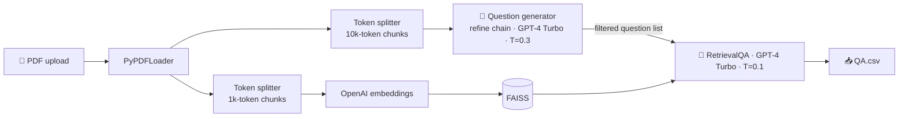

<div align="center">

# 📚 QuizForge

### Turn any technical PDF into an interview-prep question bank with grounded answers

*Upload a 100-page deep-learning PDF and download a CSV of questions with answers taken from the document.*

<br/>


</div>

---

## 💡 What it does

Studying for an ML interview from a long textbook or lecture PDF is slow. QuizForge reads the whole document and does two jobs:

1. **Writes the questions.** It walks through the PDF chunk by chunk with a LangChain **refine** chain, improving and extending the question list as it reads.
2. **Answers them from the source.** Each question goes through **RAG over a FAISS index of the same PDF**, so the answers come from the document instead of the model's memory.

The output is a downloadable **`QA.csv`** of question/answer pairs.

---

## 🧭 How it works



Design details:
- **Two chunk sizes for two jobs.** Large 10k-token chunks give the question writer broad context. Small 1k-token chunks give the answer retriever precise matches.
- **Two temperatures.** 0.3 for varied questions, 0.1 for faithful answers.
- **Custom prompts.** The writer is told to act as an exam and interview coach (`src/prompt.py`), and the refine prompt keeps the original questions when a new chunk adds nothing.
- **Question filtering.** Only lines ending in `?` or `.` are kept, so stray headings don't end up in the CSV.

A sample run on a deep-learning PDF is in [`answer.txt`](answer.txt). It covers perceptrons, optimisers, RNN/LSTM/GRU, activation and loss functions, and Transformers.

---

## 🚀 Quickstart

```bash
git clone https://github.com/nishantrv/PDF-QA-Engine-Langchain-OpenAI-FastAPI-.git
cd PDF-QA-Engine-Langchain-OpenAI-FastAPI-
python -m venv .venv && source .venv/bin/activate       # Windows: .venv\Scripts\activate
pip install -r requirements.txt
echo "OPENAI_API_KEY=sk-..." > .env
uvicorn app:app --host 0.0.0.0 --port 8080 --reload
```

Open http://localhost:8080, upload a PDF, then click **Generate QA CSV**.

| Route | Method | Purpose |
|---|---|---|
| `/` | GET | Upload UI |
| `/upload` | POST | Saves the PDF to `static/docs/` (async, with `aiofiles`) |
| `/analyze` | POST | Runs the pipeline and returns the path to `static/output/QA.csv` |

Sample PDFs to try are in `data/`: `DL.pdf`, `NLP.pdf` and `GenAI.pdf`.

---

## 🗂️ Layout

```
app.py              FastAPI routes: upload → analyze → CSV
src/helper.py       file_processing() + llm_pipeline(): splitting, refine chain, FAISS, RetrievalQA
src/prompt.py       Question-generation and refine prompts
templates/index.html  Upload / generate UI
research/experiment.ipynb  Prototype notebook
data/               Sample PDFs
```

---

## 🧰 Tech stack

**FastAPI** · **LangChain** (refine summarize chain, RetrievalQA) · **OpenAI GPT-4 Turbo + Embeddings** · **FAISS** · **PyPDF** · **tiktoken** · **Jinja2** · **aiofiles**

---

<div align="center">

Built by **[Nishant](https://github.com/nishantrv)**. If this was useful, a ⭐ is appreciated.

</div>
